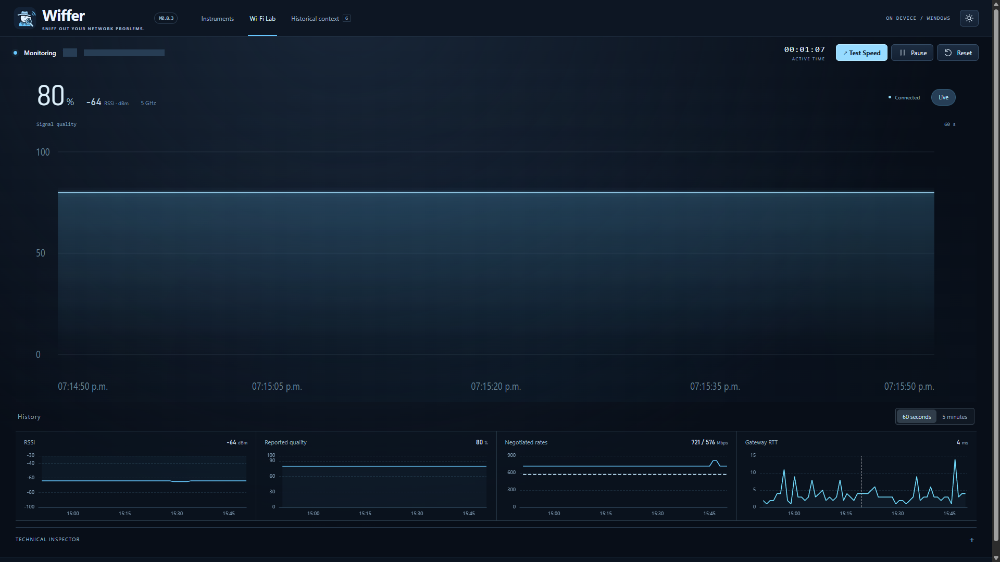
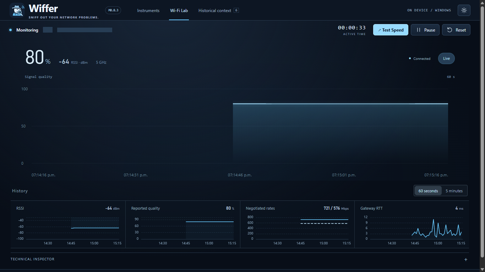
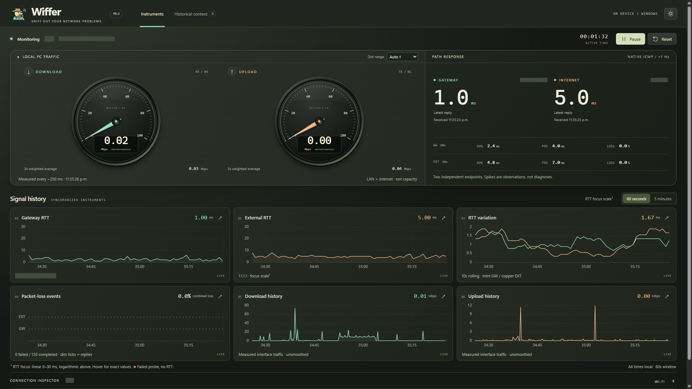

<p align="center"></p>

# Wiffer

**Wiffer — Sniff out your network problems.**

A local Windows network instrument with digital EV-style instruments, synchronized signal histories and honest measurements. Follow your gateway and internet response times alongside the traffic actually passing through your PC.

## Wi-Fi Lab · Live Signal Surface (M0.8.3)

A full-width signal timeline driven by real Windows observations. Quality uses a fixed 0–100% scale; RSSI remains separate. Hover for exact values and native timestamps, drag through retained history, wheel or pinch between 60-second and five-minute windows, and click to pin an observation. Return to Live resumes following acquisition. Keyboard inspection and reduced motion are supported. Four linked charts and the technical inspector remain below the surface.





Actual native application captures with network identifiers masked. Constant measurements stay flat; missing observations leave gaps. [Inspection capture](docs/screenshots/m083-inspection-1920x1080.png) · [Validation and limitations](HANDOFF.md). Build from source for M0.8.3; the packaged release below remains M0.7. No new release is published.

## Download

**[Download Wiffer for Windows x64](https://github.com/shafaii/wiffer/releases/download/v0.7.0/Wiffer-0.7.0-win-x64.zip)** · [Release notes](https://github.com/shafaii/wiffer/releases/tag/v0.7.0)

1. Download and extract the **entire ZIP** into a permanent folder.
2. Run `Wiffer.exe`. Windows 11 x64 and Microsoft Edge WebView2 Evergreen Runtime are required. The .NET runtime is included.
3. Optionally run `Install-Wiffer.ps1` from the extracted folder to copy the app into `%LOCALAPPDATA%\Programs\Wiffer` and create `Wiffer.lnk`. The shortcut uses an absolute executable and icon target, so it can be copied anywhere on this PC. Keep the installed folder in place.

The release is unsigned; Windows may show its normal downloaded-app reputation prompt. No administrator rights are required for normal operation. Install WebView2 from [Microsoft](https://developer.microsoft.com/microsoft-edge/webview2/) if it is missing.

```powershell
# From the extracted release folder:
& .\Wiffer.exe
# Optional per-user installation and shortcut:
& .\Install-Wiffer.ps1 -Source .
Copy-Item "$env:LOCALAPPDATA\Programs\Wiffer\Wiffer.lnk" ([Environment]::GetFolderPath('Desktop')) -Force
```

## The instruments



Actual WPF/WebView2 application capture. Solid masks conceal network identifiers; chart values and traffic readings are real, unmodified observations. No synthetic telemetry or replay is used. [Compact 1366×768 capture](docs/screenshots/viewport-1366x768.png).

- **Digital cockpit:** midnight graphite, sky/glacier blue and icy white; angular instruments with layered depth, illuminated spring-driven arcs, exact instantaneous Mbps and separate weighted averages. Dynamic ranges and reduced-motion support.
- **On-demand Quick Speed Test:** explicit, bounded native HTTPS transfers to Cloudflare, live and sustained download/upload, idle/loaded HTTP latency, endpoint details, duration, cancel and clear errors. Warns before loading the connection; never runs automatically.
- **Measured diagnostics:** native cadence/provider time, sample delivery, frame-callback delay and sequence gaps. Direct adapter counter reads and sample-triggered bridge delivery reduce acquisition and queueing work.
- **Six synchronized charts:** gateway RTT, external RTT, rolling RTT variation, packet-loss events, download and upload. Shared 60-second/5-minute windows, precise hover inspection and expandable charts.
- **Native connection inspector:** physical adapter, independent Wi-Fi fields, negotiated rates and cumulative interface counters, with explicit unavailable states.
- **Reliable session controls:** pause, resume, reset and configurable IPv4 probe targets; cancellation never counts as packet loss.
- **Historical context:** six original troubleshooting summaries, separate from live readings, without invented dates or individual samples.
- **Local by design:** no account, cloud telemetry, packet inspection, automatic speed test or measurement database. ICMP probes contact the configured endpoints. Assets and fonts are local.

**Quick Speed Test measures internet ↔ PC throughput through Windows routing. It transfers up to 384 MB of payload (+ overhead) and may temporarily increase gaming latency. It is not PC-to-modem LAN capacity; a compatible local endpoint is required for that.** Results include HTTP overhead and can understate very fast connections. [Speed-test interface](docs/screenshots/quick-speed-test.png) · [Observed diagnostics](docs/screenshots/telemetry-diagnostics.png).

**Traffic means LOCAL PC TRAFFIC through the selected physical interface, including LAN traffic and other applications. It is not internet capacity or the negotiated Wi-Fi rate.** A latency spike is an observation, not a diagnosis.

## Build from source

Requirements: Windows 11 x64, .NET 10 SDK, Node.js 22.12+ with npm, and WebView2 Evergreen. Run in the repository root:

```powershell
npm --prefix ui ci
npm --prefix ui run check
npm --prefix ui test
npm --prefix ui run build
dotnet test PulseDeck.slnx
dotnet build PulseDeck.slnx -c Release
dotnet publish src/PulseDeck.Windows/PulseDeck.Windows.csproj -c Release -r win-x64 --self-contained true -p:DebugType=None -p:DebugSymbols=false -o artifacts/wiffer-win-x64
& .\artifacts\wiffer-win-x64\Wiffer.exe
```

Source solution/project names retain `PulseDeck` to preserve architecture and source continuity. The executable, product metadata, local origin and visible application are Wiffer. The checked-in SVG, PNG and multi-resolution ICO require no asset-generation tools to build.

## Architecture

WPF hosts bundled React/TypeScript in WebView2. `src/PulseDeck.Core` owns ICMP, physical-interface byte counters and bounded Native Wi-Fi parsing. Bridge v2 validates both directions: approximately 1 Hz acquisition-triggered probe/connection snapshots (with a timer fallback) and separate approximately 4 Hz incremental traffic batches. Six stable ECharts instances render bounded histories; JavaScript never generates live measurements.

See [ARCHITECTURE.md](ARCHITECTURE.md) for measurement mathematics, security boundaries and lifecycle behavior, [HANDOFF.md](HANDOFF.md) for observed validation, and [ROADMAP.md](ROADMAP.md) for scope. M0.8 stops before band switching and M1.

## Validation and limits

71 native tests and 35 frontend tests pass for M0.8.3. TypeScript, frontend production build and Release solution build pass. M0.8 packaging/publication is not performed; the earlier M0.7 release remains available. Live checks exercise pause/reset/resume, historical summaries, invalid settings, chart identity and both requested viewport sizes. Frame measurements are browser callback timings, **not GPU present events or a guaranteed 120 FPS claim**.

Unsupported Wi-Fi fields stay unavailable. Driver retry/frame-failure counters, IPv6/DNS targets, persistence and recording are outside this release. Task Manager agreement, physical network transitions, VPN/multiple-adapter configurations, high-DPI layouts, long-duration soak and clean second-PC deployment still require manual validation.

## License

[MIT](LICENSE) for original code and artwork. [Third-party notices](THIRD-PARTY-NOTICES.md) and full dependency licenses are included with the source and release.


## In action: Downloading a game


During a real game download, Wiffer observed approximately
492 Mbps of incoming PC network traffic, alongside fluctuations
in gateway and external internet latency.

The synchronized charts showed:
- Sustained download activity in the hundreds of Mbps.
- Gateway and internet response-time spikes.
- Changing RTT variation (jitter).
- 0% observed ICMP packet loss in the displayed window.

This illustrates why high download speeds do not necessarily
mean consistently low gaming latency. Wiffer displays these
measurements together without assuming that correlation proves
the cause.

*Real measurements from one Windows PC; results will vary.*
